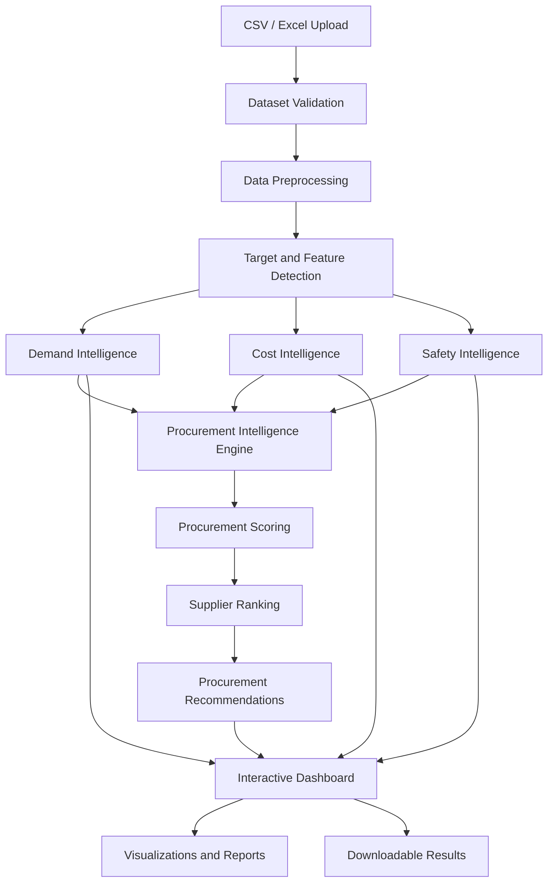

# DemandIQ — AI-Powered Enterprise Procurement Intelligence Platform

An ML-powered decision-support platform for industrial procurement that combines demand prediction, cost prediction, safety risk assessment, and supplier intelligence to support data-driven procurement decisions.

**Built with Python, Streamlit, Scikit-learn, Pandas, NumPy, and Plotly.**

---

## Overview

Industrial procurement involves multiple interconnected decisions, including estimating material demand, evaluating costs, assessing safety risks, comparing suppliers, and determining the appropriate procurement strategy.

**DemandIQ** addresses these challenges through an integrated machine learning and analytics platform. Users can upload procurement datasets, automatically preprocess data, identify prediction targets, train and evaluate machine learning models, and explore the resulting insights through an interactive dashboard.

The platform combines its analytical outputs in a Procurement Intelligence Engine that generates supplier rankings, procurement scores, procurement situation classifications, and recommendations for in-house, external supplier, or hybrid procurement.

Unlike a conventional reporting dashboard, DemandIQ connects predictive analytics with procurement decision support.

## Key Features

* **Automated Data Processing:** Upload CSV and Excel datasets for validation, preprocessing, and schema analysis.
* **Intelligent Target Detection:** Identify candidate target variables for demand, cost, and safety analysis, with manual configuration options.
* **Demand Intelligence:** Apply machine learning models to predict demand from historical procurement records.
* **Cost Intelligence:** Estimate costs and evaluate model performance using regression metrics.
* **Safety Intelligence:** Support safety risk assessment through classification or regression, depending on the selected target.
* **Supplier Intelligence:** Compare suppliers and identify supplier leaders across relevant procurement dimensions.
* **Procurement Scoring:** Integrate demand, cost, and safety information into procurement scores.
* **Procurement Recommendations:** Support decisions involving in-house production, external suppliers, or hybrid procurement.
* **Interactive Visualizations:** Explore predictions, model metrics, feature importance, supplier rankings, and procurement distributions.
* **Model Evaluation:** Compare candidate models using appropriate evaluation metrics.
* **Downloadable Results:** Export analytical results and datasets for further analysis.
* **Multi-Dataset Support:** Upload multiple compatible datasets and merge them using a selected common column.

---

## Intelligence Modules

### 1. Demand Intelligence

Demand Intelligence applies machine learning to estimate demand using the selected target variable and available features.

**Capabilities**

* Automatic or manual target selection.
* Regression or classification task detection.
* Candidate model training and evaluation.
* Actual-versus-predicted analysis.
* Prediction error analysis for regression tasks.
* Feature importance visualization where supported.
* Downloadable prediction results.

**Evaluation metrics**

For regression tasks:

* R²
* Mean Absolute Error (MAE)
* Root Mean Squared Error (RMSE)
* Mean Absolute Percentage Error (MAPE)

For classification tasks:

* Accuracy
* Precision
* Recall
* F1-score

> DemandIQ performs machine learning-based demand prediction. It should not be described as a dedicated time-series forecasting system.

### 2. Cost Intelligence

Cost Intelligence estimates procurement costs and helps evaluate the performance of candidate machine learning models.

**Capabilities**

* Cost target identification.
* Regression or classification based on the selected target.
* Candidate model evaluation.
* Actual-versus-predicted cost analysis.
* Cost error analysis for regression tasks.
* Feature importance visualization where supported.
* Downloadable cost prediction results.

For regression tasks, performance is evaluated using R², MAE, RMSE, and MAPE.

### 3. Safety Intelligence

Safety Intelligence evaluates safety-related procurement variables using a machine learning model appropriate to the selected target.

**Capabilities**

* Safety target configuration.
* Automatic task-type detection.
* Classification or regression model evaluation.
* Actual-versus-predicted analysis.
* Safety prediction error analysis for regression tasks.
* Classification performance evaluation.
* Downloadable analytical results.

Classification metrics include Accuracy, Precision, Recall, and F1-score.

Model performance depends on the quality, representativeness, and reliability of the uploaded dataset.

### 4. Procurement Intelligence

Procurement Intelligence integrates the outputs of the demand, cost, and safety pipelines to support supplier evaluation and procurement decisions.

**Capabilities**

* Supplier comparison and ranking.
* Supplier recommendations for industrial parts.
* Procurement scoring.
* Procurement situation identification.
* In-house versus external supplier evaluation.
* Hybrid procurement recommendations.
* Procurement score distribution analysis.
* Supplier-level analytical summaries.

The procurement engine combines predictive outputs with procurement decision logic to produce recommendations.

**Procurement workflow**

Dataset → Validation → Preprocessing → Target Detection → Demand Prediction → Cost Prediction → Safety Assessment → Procurement Scoring → Supplier Ranking → Procurement Recommendation

Recommendations are intended to support decision-making and should be interpreted in the context of actual operational constraints and business requirements.

---

## System Architecture

DemandIQ follows a modular architecture that separates data processing, machine learning, decision logic, visualization, and application navigation.



### Processing workflow

1. Upload one or more procurement datasets.
2. Validate the uploaded data and inspect its schema.
3. Preprocess the data for analysis.
4. Detect or configure the relevant target variables.
5. Identify the associated machine learning task types.
6. Train and evaluate candidate models.
7. Generate predictions and model performance metrics.
8. Integrate relevant outputs into Procurement Intelligence.
9. Display supplier rankings, procurement scores, and recommendations.
10. Explore and download the results.

---

## Technology Stack

| Category              | Technologies              |
| --------------------- | ------------------------- |
| Programming Language  | Python                    |
| Application Framework | Streamlit                 |
| Data Processing       | Pandas, NumPy             |
| Machine Learning      | Scikit-learn              |
| Gradient Boosting     | XGBoost, where configured |
| Data Visualization    | Plotly, Matplotlib        |
| Excel Processing      | OpenPyXL, XlsxWriter      |
| Model Utilities       | Joblib                    |
| Deployment            | Streamlit Community Cloud |
| Version Control       | Git and GitHub            |

The application uses a modular codebase to separate preprocessing, model execution, visualization, navigation, and procurement decision logic.

---

## Project Structure

The following illustrates the main application components. Refer to the repository for the complete and current directory structure.

```text
DemandIQ-Industrial-Procurement-Intelligence-Platform/
│
├── dashboard/
│   └── dashboard.py
│
├── preprocessing/
│   ├── data_processor.py
│   └── validation.py
│
├── models/
│   ├── model_engine.py
│   └── model_utils.py
│
├── visualization/
│   └── plotly_charts.py
│
├── requirements.txt
├── README.md
├── navigation.py
└── theme.py
```

### Main components

| Component                         | Responsibility                                                   |
| --------------------------------- | ---------------------------------------------------------------- |
| `dashboard/dashboard.py`          | Main Streamlit application and dashboard orchestration           |
| `preprocessing/data_processor.py` | Dataset preprocessing, target detection, and task identification |
| `preprocessing/validation.py`     | Dataset validation                                               |
| `models/model_engine.py`          | Machine learning pipeline execution                              |
| `models/model_utils.py`           | Supporting model utilities, where used                           |
| `visualization/plotly_charts.py`  | Interactive chart generation                                     |
| `navigation.py`                   | Application navigation and reusable interface components         |
| `theme.py`                        | Application styling and theme configuration                      |
| `requirements.txt`                | Python dependency definitions                                    |

---

## Installation and Local Setup

### Prerequisites

* Python 3.10 or a compatible version supported by the installed dependencies.
* Git.
* An internet connection for installing dependencies.

### Step 1: Clone the repository

```bash
git clone https://github.com/Abhinav-Singh025/DemandIQ-Industrial-Procurement-Intelligence-Platform.git
```

Navigate to the project directory:

```bash
cd DemandIQ-Industrial-Procurement-Intelligence-Platform
```

### Step 2: Create a virtual environment

**Windows**

```bash
python -m venv .venv
```

Activate it in Command Prompt:

```bat
.venv\Scripts\activate.bat
```

Or activate it in PowerShell:

```powershell
.\.venv\Scripts\Activate.ps1
```

**Linux or macOS**

```bash
python3 -m venv .venv
source .venv/bin/activate
```

### Step 3: Install dependencies

Install the dependencies declared in `requirements.txt`:

```bash
python -m pip install --upgrade pip
pip install -r requirements.txt
```

### Step 4: Launch the application

Run the Streamlit application from the repository root:

```bash
streamlit run dashboard/dashboard.py
```

Streamlit will display the local application URL in the terminal. The default address is:

```text
http://localhost:8501
```

Open the address in your browser.

---

## Deploying on Streamlit Community Cloud

DemandIQ can be deployed using Streamlit Community Cloud.

### Deployment steps

1. Push the project to a GitHub repository.

2. Open [Streamlit Community Cloud](https://share.streamlit.io/).

3. Create a new app.

4. Select the repository:

   `Abhinav-Singh025/DemandIQ-Industrial-Procurement-Intelligence-Platform`

5. Select the deployment branch:

   `main`

6. Set the main file path to:

   `dashboard/dashboard.py`

7. Deploy the application.

8. Monitor the deployment logs until the app starts successfully.

### Dependency configuration

Ensure that `requirements.txt` exists in the repository root.

The application dependencies should be declared there so Streamlit Community Cloud can install them during deployment.

If the application fails to start:

* Inspect the complete deployment logs.
* Check whether dependency installation completed successfully.
* Verify the repository, branch, and entry-point configuration.
* Confirm that all required local modules are committed to GitHub.
* Check that package versions are compatible with the deployed Python environment.

For the original repository, use the dependency versions already tested by the project before changing package versions.

---

## Using DemandIQ

### Step 1: Upload data

Open the application and upload a procurement dataset in CSV or Excel format.

For multiple datasets, the application can merge compatible datasets using a common column.

### Step 2: Inspect the dataset

Review:

* Number of records and columns.
* Data types and schema.
* Missing values and duplicate records.
* Detected entity and supplier columns.
* Preprocessing diagnostics.

### Step 3: Configure prediction targets

Review the automatically detected demand, cost, and safety targets.

Use the available sidebar controls to select the appropriate columns when manual configuration is needed.

Ensure that the selected targets represent meaningful business outcomes in the uploaded dataset.

### Step 4: Review machine learning results

Navigate to the Demand Intelligence, Cost Intelligence, and Safety Intelligence modules.

Review the selected models, evaluation metrics, predictions, and available visualizations.

### Step 5: Explore procurement recommendations

Open Procurement Intelligence to inspect:

* Supplier rankings.
* Procurement scores.
* Procurement situations.
* Recommended suppliers.
* In-house, external supplier, or hybrid procurement recommendations.

### Step 6: Export results

Use the available download controls to export supported analytical outputs for reporting or further analysis.

---

## Model Evaluation

DemandIQ supports evaluation metrics appropriate to the machine learning task.

| Metric    | Task           | Purpose                                                                                                     |
| --------- | -------------- | ----------------------------------------------------------------------------------------------------------- |
| R²        | Regression     | Measures the proportion of target variance explained by the model                                           |
| MAE       | Regression     | Measures average absolute prediction error                                                                  |
| RMSE      | Regression     | Penalizes larger prediction errors more heavily                                                             |
| MAPE      | Regression     | Expresses prediction error as a percentage, subject to limitations when actual values are zero or near zero |
| Accuracy  | Classification | Measures the proportion of correct predictions                                                              |
| Precision | Classification | Measures the proportion of predicted positives that are correct                                             |
| Recall    | Classification | Measures the proportion of actual positives identified                                                      |
| F1-score  | Classification | Balances precision and recall                                                                               |

Model selection and performance depend on the dataset, target definition, preprocessing, train-test split, and evaluation methodology.

Results obtained from a particular dataset should not automatically be interpreted as evidence of equivalent performance on unseen industrial data.

---

## Data Requirements and Limitations

DemandIQ is designed to process tabular procurement datasets, but useful results depend on the information provided.

For meaningful analysis:

* Use clearly named columns with consistent data types.
* Include sufficient relevant observations for model training and evaluation.
* Select target variables that represent the business outcomes being investigated.
* Ensure that demand and cost fields contain meaningful values.
* Use reliable supplier, entity, and safety information when evaluating procurement decisions.
* Review preprocessing diagnostics and model metrics before acting on recommendations.

### Important limitations

* Automatic target detection may require manual correction when column names or data semantics are ambiguous.
* A syntactically valid dataset is not necessarily suitable for machine learning.
* Performance metrics can be misleading when targets contain leakage, severe class imbalance, duplicates, or synthetic patterns.
* Supplier rankings depend on the available supplier records and the logic implemented in the procurement engine.
* Procurement recommendations are decision-support outputs, not guarantees of cost savings, supplier reliability, or operational safety.
* Production use requires validation against representative real-world data, operational constraints, and domain-specific requirements.

---

## Future Enhancements

Potential directions for extending the platform include:

* Integration with procurement databases and enterprise resource planning systems.
* More robust schema inference and data quality diagnostics.
* Improved model monitoring and reproducible model evaluation.
* Persistent storage of analysis history and prediction results.
* API-based access to prediction and procurement intelligence services.
* Authentication and role-based access control.
* Containerization and automated deployment workflows.
* Expanded testing with representative industrial datasets.

These are potential enhancements rather than claims about currently implemented features.

---

## Project Applications

DemandIQ can support exploratory procurement analysis in settings such as:

* Manufacturing and industrial operations.
* Inventory and material planning.
* Supplier evaluation and comparison.
* Procurement cost analysis.
* Safety-related procurement assessment.
* In-house versus outsourced production analysis.
* Data-driven procurement planning.

Actual suitability depends on dataset quality, model validation, and the specific operational context.

---

## Author

**Abhinav Singh**

B.Tech — Computer Science

Project: **DemandIQ — AI-Powered Enterprise Procurement Intelligence Platform**

Developed as an industrial procurement analytics and decision-support project.

---

## License

No license is specified in this README. Add an appropriate `LICENSE` file to the repository if you intend to publish the project under an open-source license.

---

## Acknowledgements

This project brings together machine learning, data preprocessing, interactive visualization, and procurement decision logic to demonstrate how predictive analytics can support industrial procurement workflows.
